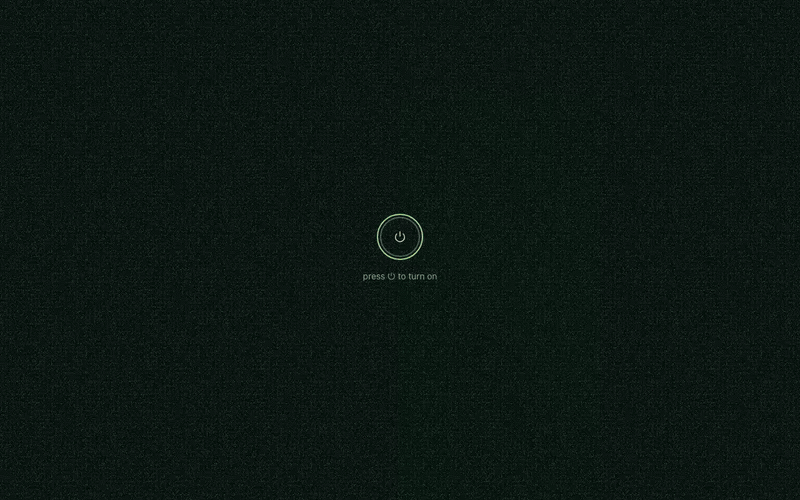
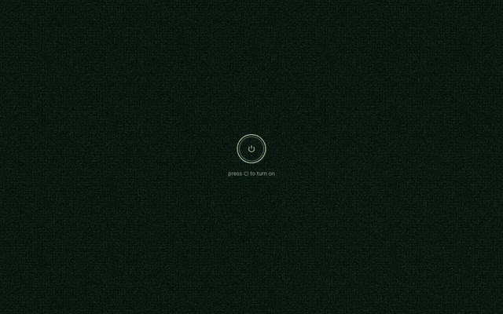
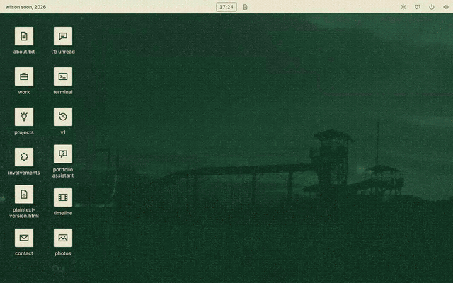
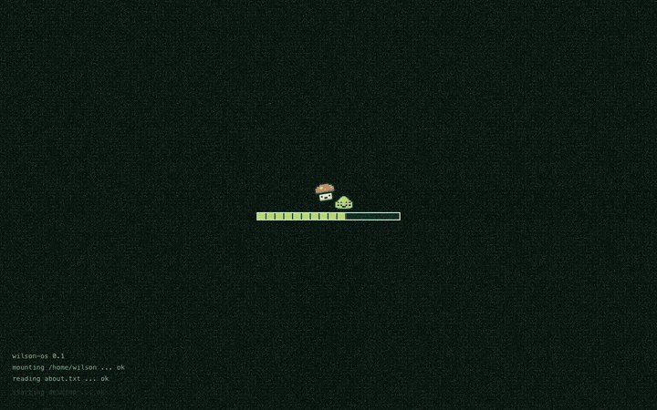
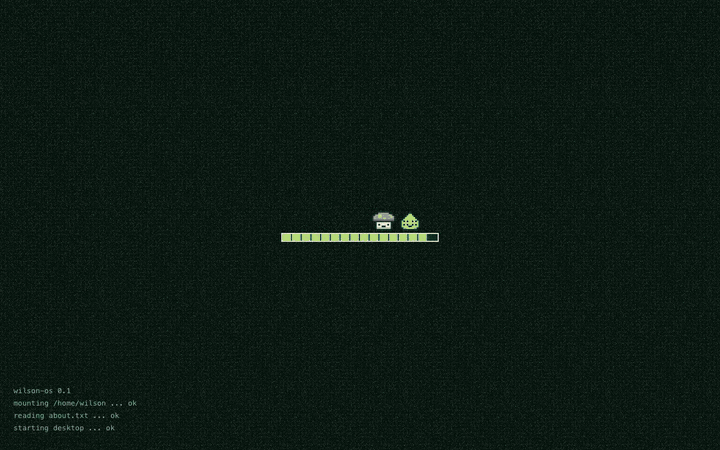

# Wilson Soon's portfolio

| doc | what it is |
|---|---|
| [learnings.md](learnings.md) | things i learned building it |
| [docs/design-rationale.md](docs/design-rationale.md) | why it looks and works this way |
| [technicals.md](technicals.md) | technical Q&A while building |
| [SPIKE-PROGRESS.md](SPIKE-PROGRESS.md) | dated handover notes |
| [docs/v2-research-notes.md](docs/v2-research-notes.md) | references and motion rules |
| [docs/ai-chat-proposal.md](docs/ai-chat-proposal.md) | AI provider research and options |
| [docs/ai-chat-decisions.md](docs/ai-chat-decisions.md) | AI choices and knowledge allowlist |
| [worker/README.md](worker/README.md) | the Worker: endpoints, limits, admin |
| [worker/knowledge.md](worker/knowledge.md) | assistant knowledge (Workers AI) |
| [worker/knowledge-short.md](worker/knowledge-short.md) | shorter knowledge (Groq fallback) |
| [deploy/vercel-redirect/README.md](deploy/vercel-redirect/README.md) | old Vercel URL redirect |
| [CLAUDE.md](CLAUDE.md) | notes for Claude Code |

A retro desktop-lookalike personal site, with an AI assistant that answers questions about me.
Live: **https://portfolio.wilsonsoon.workers.dev**

## Vibes

- **Retro green two-tone print.** Deep green ink on cream paper, a static film-grain layer, and a dark mode in
  green-black. The wallpaper is a grayscale photo mapped between two greens, so any photo stays inside the palette.
- **A desktop, not a page.** Top bar, app icons, draggable windows, a dock for minimised ones. Phones get full-screen
  sheets instead of drag and resize.
- **Restraint.** Colour is the theme and one accent, matte bubbles, solid paper panels instead of translucency, lowercase
  labels. The boot is first-visit only and skippable; the plain version of the content is always one icon away.
- **Motion with rules.** Delight only for rare moments (boot, CRT off, scroll roll-out); frequent actions are fast.
  Transitions that can be interrupted, `cubic-bezier(0.23,1,0.32,1)` for enter/exit, never ease-in, exits faster than
  entrances, and a gentler (not zero) reduced-motion mode.
- **Original art.** Pixel cursor, a star-eyed slime and a mushroom on the boot bar, all drawn from scratch.

## Inspiration

- [Sequel's blue-and-cream footer, listed under Pranav on Inspora](https://www.inspora.design/posts/footer-section), for the grainy two-tone print palette (adapted to green; original designer unverified).
- [Emil Kowalski](https://emilkowal.ski/ui/you-dont-need-animations), for animation principles, stagger and tooltips.
- [Demon Slayer: Kimetsu no Yaiba Promotion Reel](https://www.youtube.com/watch?v=QwvWdnd2Ktg), published by Aniplex USA / animation by ufotable, for the paper-scroll timeline (the border pattern is my own).
- [Zara Zhang's interactive text story](https://zara.small.world/jensenchat/), for the self-playing "(1) unread" thread.
- [Terminal Industries](https://terminal-industries.com/), for scene-transition inspiration.
- Terminal portfolios (satnaing/terminal-portfolio, davidesantangelo.com and others) for the terminal.
- [MapleStory / Nexon](https://www.maplestory.com/), for the creature inspiration; this site's sprites are drawn from scratch.
- A pixel Star Wars loading-bar clip, for characters riding a progress bar; its creator remains unverified.

The 11 original reference files are versioned in [referenceideas-for-portfolio/](referenceideas-for-portfolio/README.md),
with source evidence and unresolved attribution noted there. They are research references, outside the deployed
`public/` assets. Concise credits also appear below contact and in the simple version.

## Noteworthy bits

### Power-on, boot and desktop
First visit: the screen powers off, then a CRT boot with a pixel bar (hover or tap and the slime hops). Return visits in
the same tab land on the desktop already on. Tooltips delay only the first hover, neighbours show instantly.



### Spirit creatures


A star-eyed slime and an orange-capped mushroom ride the boot bar, hopping along its fill (the mushroom trails). Hover
or tap one and it does a big squash-and-stretch hop. They come back in the tour's "done" window, hopping beside
"immortalising my being in (retro) pixels". Original pixel art, one character per pixel in `BootBar.tsx`, lightly
MapleStory-flavoured but drawn from scratch. The SVG above is generated from that same pixel data.

### First-visit tour
A small "welcome / tour?" window asks once per tab: **no**, **yes**, or the rightmost orange **view simple** button.
View simple opens the maximised simple version immediately and dismisses onboarding for the tab.
Yes: about.txt opens and the tour steps through work, projects,
involvements and contact, one maximised window at a time, with next / back / "skip → (view simple)" in the corner. It ends
with a small "done" window.
Tour controls explain themselves on hover or keyboard focus; narrow screens wrap the controls so they stay reachable.



### Photo timeline and Photos app
Four paper lanes (career, people, me, scenery) unroll over the desktop and drift on a loop; drag to throw them. Clicking
a photo opens it in an iCloud-style Photos app (114 photos): chronological grid, albums, month jump, a viewer with swipe,
zoom to 4x and a filmstrip.



### Terminal
`help`, `ls`, `cat <file>`, `open` / `close <app>`, `ask <question>`, `assistant` (a Claude Code / Codex-style chat inside the terminal: `>` prompt, ⏺ answers, `/image`, `/clear`, `/exit`; pictures are auto-detected), `whoami`, `neofetch`, `theme`, history, tab
completion, plus a few jokes. It is a second route to the same content.



### Portfolio assistant
A chat that answers questions about me from a hand-written knowledge file, and draws pictures (including illustrated
ones of me) from an "image" button. It runs on Workers AI and falls back to Groq (text only) when the free daily limit
is gone. The same backend powers the "(1) unread" messages app. If it can't answer, the question is logged and I answer
it at `/admin`; saved answers go back into the chat.



### Also
- **simple version.** The full content as a plain page, one top-bar icon away, for skimmers and recruiters.
- **Expand/collapse.** Work, projects and involvements keep the control beside the summary title in both views.
- **Theme toggle.** Sun/moon in the top bar, synced with the simple footer toggle and the terminal `theme` command.
- **Phones.** Full-screen sheets, a flowing top bar, a touch cursor (hold a finger down and the pixel arrow appears above it).
- **Sound.** Web Audio power-off and switch-on sounds with a persisted toggle.
- **/admin.** Token-gated page to answer unanswered questions and read the chat log (30 days, per-tab random id, no IP,
  disclosed under the chat input).
- **v1.** The old Astro site still lives inside the desktop as an icon.

## Tech stack

**Frontend**
- Vite + React 19 + TypeScript: the app and build.
- Tailwind v4 (CSS-first) plus hand-written CSS: tokens and the greeting styles.
- `motion`: animation where transitions alone don't do it.
- Web Audio: power-on/off sounds.

**Edge / backend**
- Cloudflare Worker `portfolio`: serves the built site as static assets and runs `/api/*` and `/admin*`.
- Wrangler: config, secrets and deploys.
- Rate Limiting binding plus an in-memory daily cap: per-visitor limits so the free allowance lasts.

**AI**
- Workers AI, `@cf/google/gemma-4-26b-a4b-it`: chat, with thinking off.
- Workers AI, FLUX.1 schnell and FLUX.2 klein 9B: images, and illustrated pictures of me from reference photos.
- Groq, `openai/gpt-oss-20b`: text-only fallback; the key is a Worker secret.

**Data**
- D1 (SQLite): unanswered questions, saved answers, chat log, private wiki chunks with FTS5 search.
- `src/data/*.json`: one content source for both the desktop and the simple version.

**Tooling**
- Plain Node test scripts for the Worker's pure logic, `tsc` typechecking.
- `sharp` via `npm run photos:add`: resize and strip metadata from photos.
- Vercel: only a tiny redirect project for the old URL.

## Learnings

- A key in the browser is public. The Worker holds it, so the browser only sends a question and gets an answer.
- `VITE_*` variables are pasted into the JavaScript at build time: public, and changing one needs a rebuild.
- Thinking models can spend all of `max_tokens` on hidden reasoning and return nothing; turn thinking off.
- A sentinel (`UNKNOWN`) beats guessing: the Worker detects it deterministically and logs the question.
- A Worker is identified only by its name: a new name is a new Worker with no secrets.

More in [learnings.md](learnings.md), with depth in [docs/design-rationale.md](docs/design-rationale.md) and
[technicals.md](technicals.md).

## Run locally / deploy

```sh
npm install
npm run dev          # vite; /api is proxied to the deployed Worker
npm run build        # tsc -b && vite build -> dist/
npm run preview      # serve the built site

# deploy site + Worker together (run wrangler logged in, from worker/ for secrets)
cd worker && npm install && npx wrangler login
npx wrangler secret put GROQ_API_KEY   # the name only; paste the value at the prompt
npx wrangler secret put ADMIN_TOKEN    # the /admin password
npx wrangler d1 migrations apply portfolio-qa --remote
cd .. && npm run deploy                # build, then wrangler deploy

cd worker && npm test                  # Worker unit tests (also: npm run typecheck)
```

The Worker only allows the origins in `ALLOWED_ORIGINS`: the live site and `localhost` ports 5173, 4321 and 4173. Vite's
default (5173) works; if you use another port, pass `-- --port 4321 --strictPort`. See [worker/README.md](worker/README.md)
for the first-time D1 setup and local Worker dev.

## Project structure

```
src/
  components/greeting/   the desktop: windows, apps, boot, tour, terminal, assistant, photos, timeline
  data/                  work, projects, activities, skills and photo JSON
  lib/ai.ts              calls /api/chat and /api/image
  styles/                global tokens and simple page styles
worker/                  Cloudflare Worker: chat, image, admin, D1 logic, knowledge files, tests
db/migrations/           D1 schema
scripts/                 photo and wiki-excerpt helpers
public/                  fonts, photos, reference images, v1 (old Astro site)
deploy/vercel-redirect/  redirect from the old Vercel URL
docs/                    design rationale, research, AI decisions, media
referenceideas-for-portfolio/  original inspiration files and source credits (not deployed)
```

## Updating the resume

`resume/resume.tex` is the source of truth. The `src/data/{work-experience,projects,activities,skills}.json` files and
`public/resume.pdf` are generated from it; don't edit them by hand.

1. Edit or paste into `resume/resume.tex`. Never paste the personal-notes `\begin{comment}` block from the top of a
   draft; `npm run resume:import -- <file>` strips it.
2. Push to `main`. The `resume-sync` workflow regenerates the JSON, runs `npm run build` as a gate, compiles the PDF
   and commits the results back as `github-actions[bot]` (nothing is committed if the build fails).
3. Deploy when ready: Actions tab -> deploy -> Run workflow (it is manual on purpose).

Locally: `npm run resume:sync` regenerates the JSON; `node scripts/resume-sync.mjs --check` fails if it is out of date
(the `ci` workflow runs this on every PR and push).

`deploy.yml` needs two repository secrets, added at Settings -> Secrets and variables -> Actions -> New repository secret:
`CLOUDFLARE_API_TOKEN` (an API token with the "Edit Cloudflare Workers" template, plus D1 and Workers AI access if the
token is scoped by hand) and `CLOUDFLARE_ACCOUNT_ID`. The Worker's own secrets (`GROQ_API_KEY`, `ADMIN_TOKEN`) stay in
Cloudflare. The bot commit needs Settings -> Actions -> General -> Workflow permissions -> Read and write.
